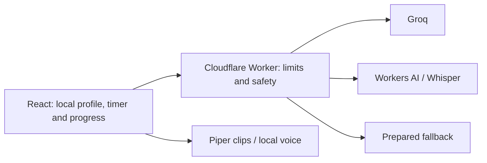

# MyPal

**A voice-led play companion for little explorers.** Built by **westcoded** for **Business Cup 2.0**.

[Try MyPal — no login](https://mypal.tarlan-b06.workers.dev) · [Audit and evidence](AUDIT.md) · [Screenshots](docs/screens) · [Privacy](docs/PRIVACY.md)

## Who it helps

Working parents in the United States need a short, predictable break while children aged 1–8 need engaging play. MyPal offers voice-led movement missions for a screen-free break, plus optional videos and learning games. Parents choose the duration; an adult should supervise young children and clear a safe play area. MyPal is not childcare or a safety monitor.

## How it works

1. Meet MyPal, then enter a nickname and age. Notes are optional and stay on the device.
2. Choose a session length: 10, 20, 30, 60 minutes or a custom limit.
3. Watch and learn, or move and play. Spoken prompts also have text/button alternatives.
4. Earn XP and spaceship parts, then pick another age-appropriate activity.
5. The timer survives reloads. At expiry, an activity gets up to 30 seconds to finish. Hold **Parents** to add five minutes or end early.

| Age | Activities |
| --- | --- |
| 1–2 | Toddler video library, animal sounds and the Animal Sounds quiz |
| 3–5 | Video + quiz, Memory, Balloon Count, movement missions |
| 6–8 | Video + quiz, Memory, Space Scale, Sketch Artist, Tic-tac-toe, Ask MyPal, movement missions |

Movement modes include Scavenger Hunt, Floor is Lava and Roadtrip Spy for passengers. YouTube loads on request and can display ads or related videos. The toddler library can autoplay muted videos. Sketch drawings stay on the device; the PNG export is optional.

## What makes it different

A single host connects spoken movement tasks, learning games, local rewards and a parent-set clock. Recorded prompts keep missions usable when cloud replies fail; optional Ask replies use guarded models and a prepared FAQ. The live mascot voice runs locally when the device supports it.

## Business model and current limits

The prototype shows **MyPal Plus: $18/month or $144/year**. These are proposed prices, not an active subscription service. The locked Dino Dig, Music Band and Story Quest cards open the plans screen; checkout, these premium games, weekly content and progress emails are not implemented. Monetisation, parental consent and provider retention need validation before launch.

There are no accounts, cross-device sync or payment processing. Reload recovery uses this browser's localStorage. Network-free recovery works while the page is loaded; there is no offline service worker guaranteeing a fresh launch. An external uptime monitor is **not configured**; `/api/health` provides a health endpoint.

## Stack and architecture

Vite + React + TypeScript + Tailwind; Hono on Cloudflare Workers; Groq for guarded replies/mission selection; Whisper through Workers AI for optional speech recognition. Voice uses pre-rendered Piper clips, optional browser-local Pocket TTS and installed browser voices.



[Detailed architecture](docs/ARCHITECTURE.md). Parent notes and nicknames stay local. Ask sends only the question. Optional STT sends audio; missions send structured game words/IDs. No camera or geolocation. This is a data-minimisation/COPPA-oriented approach, not compliance certification.

## Run locally

Use Node.js 24:

```sh
npm i
npm run dev
```

For a reproducible install use `npm ci`. Open Vite's printed URL. `.env.example` lists binding names without secrets. Copy `.dev.vars.example` to untracked `.dev.vars` only when local cloud features are needed; Cloudflare AI bindings can contact paid remote services even during development. Never put secrets in `VITE_*` variables. [Deployment instructions](docs/DEPLOY.md).

## Checks

```sh
npm run typecheck
npm run lint
npm run build
npm run check-content
npm run check-sketch
npm run check-space
npx tsx scripts/worker-tests.ts
npx playwright install chromium
npm run smoke
```

`lint` runs TypeScript's unused-code checks for both client and Worker; it is not an ESLint style pass. `smoke` defaults to the live site. For safe local runs, start `npm run preview`, set `SMOKE_URL` to its URL and `SMOKE_MOCK_API=1`, then run `npm run smoke`. Set `CHROME_PATH` to an existing Chrome executable if Chromium is not installed. Screenshots/report go to `docs/screens`; use `SMOKE_OUTPUT` to change that. `SMOKE_SIZES` accepts comma-separated width×height values using `x`. `SMOKE_FONT_SCALE=2` checks enlarged root text. Provider failures are mocked; the test does not certify real microphone audio or YouTube playback.

## Repository map

- `src/screens`, `src/components`: screens and shared interactions.
- `src/games`: isolated learning games; `src/game`: mission/content logic.
- `src/audio`, `src/voice`: audio playback and optional recording.
- `src/state`: device-local profile, rewards and session clock.
- `worker`, `shared`: API safety, contracts and FAQ.
- `content`, `public/audio`: prompt text and recorded clips.
- `scripts`: generation, validation and audit tools.
- `docs`: deployment, privacy, architecture and test evidence.

## Deploy

After reviewing the audit, run the checks above, then `npx wrangler login` and `npx wrangler deploy --keep-vars`. Preserve the MyPal production origin in `ALLOWED_ORIGINS`. Do not overwrite dashboard model secrets. Record the source commit and Cloudflare version; [DEPLOY.md](docs/DEPLOY.md) covers rollback. The current audit changes have **not been deployed**.

## Voice clips

Games and quizzes share nine quiet music themes and matching animated decorations. **Music on/off** controls the background separately; **Sound off** mutes it too. Music pauses for microphone use, hidden tabs and parent dialogs, and stays off during videos. Reduced-motion settings disable decoration movement. Tracks are generated locally without audio downloads. See the [follow-up audit and staged plan](docs/AUDIT-2026-11-17.md) for checks and device-testing limits.

Pocket TTS clones the approved `content/voice/host-voice.json` reference locally. Its model download is about 146 MB and is skipped on Data Saver or low-memory devices. Piper MP3s remain available while it loads; timed cues use recordings. The checked-in patch adjusts the voice temperature without replacing its identity.

```sh
python -m pip install piper-tts==1.8.0
python -m piper.download_voices --data-dir scripts/.cache/models en_US-hifi_tts_92-medium
npm run gen-audio -- --dry-run
npm run gen-audio
npm run check-content -- --require-audio
```

Python and FFmpeg with `libmp3lame` are required for generation. `PYTHON` and `FFMPEG` can select executables; `--only` filters clip IDs. On Windows use a Latin-character tool path if Piper cannot open the workspace path. Keep weights outside Git. [Voice credits](content/AUDIO_CREDITS.md).
