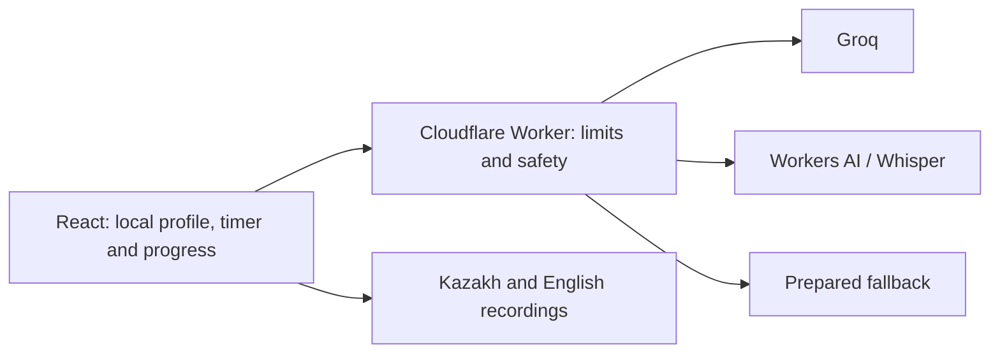

# AIdos

**A voice-led play companion for little explorers.** Built by **westcoded** for **Business Cup 2.0**.

[Try AIdos — no login](https://aidos.nexcel.kz) · [Audit and evidence](AUDIT.md) · [Screenshots](docs/screens) · [Privacy](docs/PRIVACY.md)

## Languages

Kazakh (`kk`) is the default. Choose **KZ | EN** on the greeting screen, in parent setup or in the Parents dialog. The choice takes effect immediately. The app saves it in `mypal.lang` and in the selected local profile. Language changes preserve progress and the session clock.

UI text lives in `src/i18n/en.ts` and `src/i18n/kk.ts`. The matching `content-en.json` and `content-kk.json` files hold mission lines, quiz choices, FAQ answers and video titles. `MessageKey` is derived from the English dictionary. Use `useT()` in components and `{brand}` for the shared name from `src/brand.ts`. Each language loads on demand. [Bilingual review table](docs/site-texts-kk.md) · [Offline Kazakh screen gallery](docs/site-kk.html).

To add a language, copy both dictionary files for the new locale, preserving keys and placeholders. Extend the locale types, loader, selector, persistence and metadata in `src/i18n`, the document and manifest setup in `src/App.tsx`, and the locale formatting rules. Add matching Worker replies, FAQ, suggested questions, quiz speech matching and a voice pack with the right STT/TTS language. Add the locale to the dictionary and browser checks. Run `npm run check:i18n`, `node scripts/i18n-worker.mjs` and `node scripts/i18n-e2e.mjs` before release. The browser check expects the built site and Worker together at `http://localhost:5173`, or a local address in `I18N_URL`.

## Who it helps

Working parents in the United States need a short, predictable break while children aged 1–8 need engaging play. AIdos offers voice-led movement missions for a screen-free break, plus optional videos and learning games. Parents choose the duration; an adult should supervise young children and clear a safe play area. AIdos is not childcare or a safety monitor.

## How it works

1. Meet AIdos, then enter a nickname and age. Notes are optional and stay on the device.
2. Choose a session length: 10, 20, 30, 60 minutes or a custom limit.
3. Watch and learn, or move and play. Spoken prompts also have text/button alternatives.
4. Earn XP and spaceship parts, then pick another age-appropriate activity.
5. The timer survives reloads. At expiry, an activity gets up to 30 seconds to finish. Hold **Parents** to add five minutes or end early.

| Age | Activities |
| --- | --- |
| 1–2 | Toddler video library, animal sounds and the Animal Sounds quiz |
| 3–5 | Video + quiz, Memory, Balloon Count, movement missions |
| 6–8 | Video + quiz, Memory, Space Scale, Sketch Artist, Tic-tac-toe, Ask AIdos, movement missions |

Movement modes include Scavenger Hunt, Floor is Lava and Roadtrip Spy for passengers. YouTube loads on request and can display ads or related videos. The toddler library can autoplay muted videos. Sketch drawings stay on the device; the PNG export is optional.

## What makes it different

A single host connects spoken movement tasks, learning games, local rewards and a parent-set clock. Recorded prompts keep missions usable when cloud replies fail; optional Ask replies use guarded models and a prepared FAQ. Fixed lines have local recordings in both languages.

## Business model and current limits

The prototype shows **AIdos Plus: $18/month or $144/year**. These are proposed prices, not an active subscription service. The locked Dino Dig, Music Band and Story Quest cards open the plans screen; checkout, these premium games, weekly content and progress emails are not implemented. Monetisation, parental consent and provider retention need validation before launch.

There are no accounts, cross-device sync or payment processing. Reload recovery uses this browser's localStorage. Network-free recovery works while the page is loaded; there is no offline service worker guaranteeing a fresh launch. An external uptime monitor is **not configured**; `/api/health` provides a health endpoint.

## Stack and architecture

Vite + React + TypeScript + Tailwind; Hono on Cloudflare Workers; Groq for guarded replies/mission selection; Whisper through Workers AI for optional speech recognition. Kazakh uses local Piper recordings. English uses Aura-2 Luna recordings and Workers AI for new speech.



[Detailed architecture](docs/ARCHITECTURE.md). Parent notes and nicknames stay local. Ask sends the question and selected language. Optional STT sends audio; missions send structured game words/IDs. No camera or geolocation. This is a data-minimisation/COPPA-oriented approach, not compliance certification.

## Run locally

Use Node.js 24:

```sh
npm i
npm run dev
```

For a reproducible install use `npm ci`. Open Vite's printed URL. `.env.example` lists binding names without secrets. Copy `.dev.vars.example` to untracked `.dev.vars` only when local cloud features are needed; Cloudflare AI bindings can contact paid remote services even during development. Never put secrets in `VITE_*` variables. [Deployment instructions](docs/DEPLOY.md).

## Checks

```sh
npm run typecheck
npm run lint
npm run build
npm run check-content
npm run check-sketch
npm run check-space
npx tsx scripts/worker-tests.ts
npx playwright install chromium
npm run smoke
```

`lint` runs TypeScript's unused-code checks for both client and Worker; it is not an ESLint style pass. `smoke` defaults to the live site. For safe local runs, start `npm run preview`, set `SMOKE_URL` to its URL and `SMOKE_MOCK_API=1`, then run `npm run smoke`. Set `CHROME_PATH` to an existing Chrome executable if Chromium is not installed. Screenshots/report go to `docs/screens`; use `SMOKE_OUTPUT` to change that. `SMOKE_SIZES` accepts comma-separated width×height values using `x`. `SMOKE_FONT_SCALE=2` checks enlarged root text. Provider failures are mocked; the test does not certify real microphone audio or YouTube playback.

## Repository map

- `src/screens`, `src/components`: screens and shared interactions.
- `src/games`: isolated learning games; `src/game`: mission/content logic.
- `src/audio`, `src/voice`: audio playback and optional recording.
- `src/state`: device-local profile, rewards and session clock.
- `worker`, `shared`: API safety, contracts and FAQ.
- `content`, `public/audio`: prompt text and recorded clips.
- `scripts`: generation, validation and audit tools.
- `docs`: deployment, privacy, architecture and test evidence.

## Deploy

Cloudflare Builds publishes `main` automatically to the `westcoded-business-cup` Worker at **https://aidos.nexcel.kz**. Run the checks above before pushing, then verify the completed build and live site. `keep_vars: true` preserves dashboard variables; never overwrite model secrets. The production origin belongs in `ALLOWED_ORIGINS`. [DEPLOY.md](docs/DEPLOY.md) records the current target, release process and rollback instructions.

## Voice clips

Games and quizzes share nine quiet music themes and matching animated decorations. **Music on/off** controls the background separately; **Sound off** mutes it too. Music pauses for microphone use, hidden tabs and parent dialogs, and stays off during videos. Reduced-motion settings disable decoration movement. Tracks are generated locally without audio downloads. See the [follow-up audit and staged plan](docs/AUDIT-2026-11-17.md) for checks and device-testing limits.

The English pack contains 238 line IDs recorded with Cloudflare Aura-2 Luna. The Kazakh pack contains 243 IDs recorded with Piper iseke. Identical lines share a recording. Each pack has its own manifest and text index in `public/audio/en/` or `public/audio/kk/`. Known lines play locally. New English replies can use the pinned cloud voice. For missing Kazakh recordings, the app uses an available Kazakh device voice and keeps the caption visible when speech is unavailable. Parent notes and nicknames stay local.

AIdos blinks, waves and speaks using nine transparent frames in `public/mascot/frames/guide.webp`. Recorded speech drives the mouth from the voice level. Device speech uses a syllable rhythm during playback. Reduced-motion mode shows still poses.

To rebuild the Kazakh pack, install Piper and FFmpeg support and download the voice weights with the matching JSON configuration next to them. Set `PYTHON` to your environment's Python if needed. Keep the weights outside Git.

```sh
python -m pip install piper-tts==1.8.0 imageio-ffmpeg
python -m piper.download_voices --data-dir scripts/.cache/models kk_KZ-iseke-x_low
npm run gen-audio -- --lang kk --model scripts/.cache/models/kk_KZ-iseke-x_low.onnx
npm run gen-audio -- --lang en
npm run check-content -- --require-audio
```

The English command indexes the existing Luna recordings. Pass `--english-source /path/to/audio` to use another copy of the source catalogue's recordings. To select a system FFmpeg build with MP3 support, set `FFMPEG`. [Voice credits](content/AUDIO_CREDITS.md).
