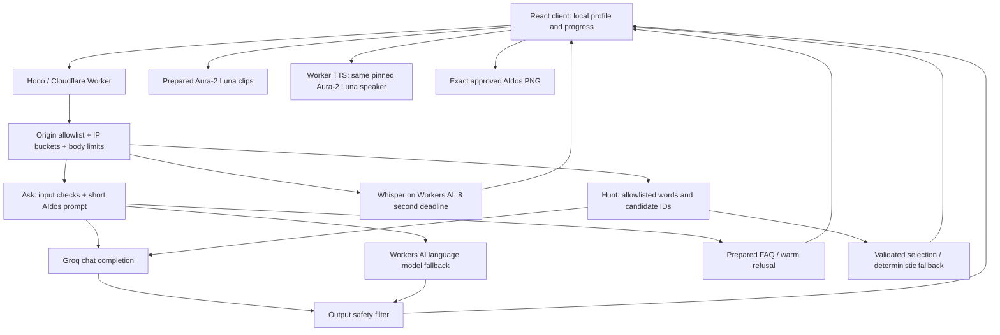

# Architecture

API shapes remain compatible: Ask returns answer/source, STT returns text (empty on retry, plus optional message), and turns return praiseLineId/nextTaskId/scoreDelta/loreNote/source. Rate-limited calls return HTTP 429 and a friendly body; existing client catch paths use local fallbacks.

Groq calls use an 8-second abort deadline. Whisper uses an 8-second response deadline; the binding does not expose cancellation, so underlying work may finish later. Ask cloud calls share a seven-second total response budget across attempts, then use prepared FAQ. A deadline cannot guarantee browser round-trip time under slow connectivity. CORS is an origin allowlist, not authentication: clients without Origin can call APIs. In-memory token buckets refill at 30/minute and 300/hour with matching burst capacities, capped at 4096 IPs and expired after inactivity. Limits are per isolate, not globally distributed quotas.

No raw user payload logging is added. Filters are conservative defence in depth, not a semantic safety proof. FAQ matches whole words and informative multiword phrases, avoiding generic water/sky matches when a more specific fish/bird question is present.
